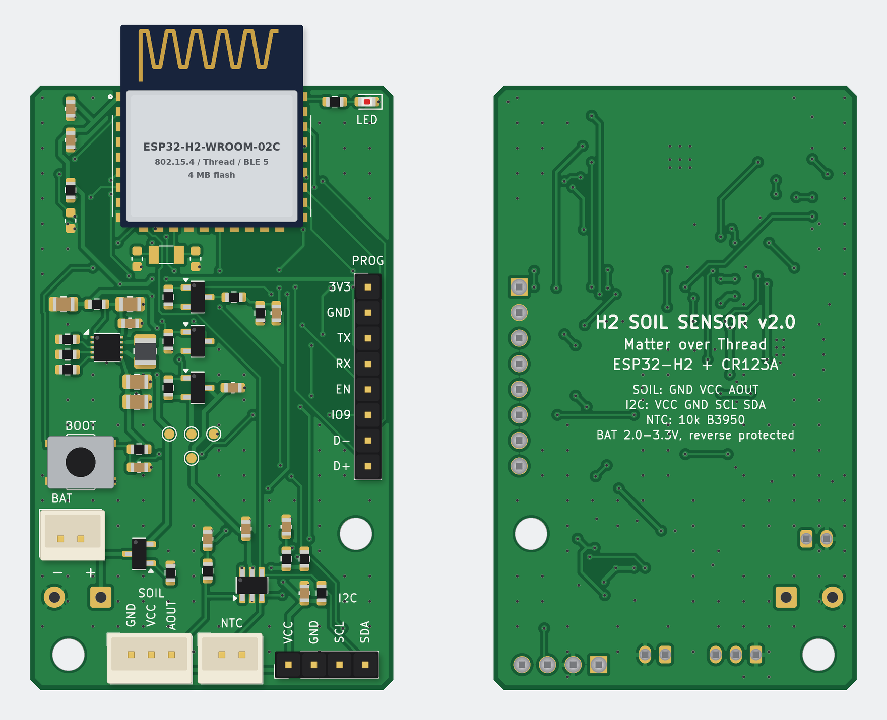

# H2 Soil Sensor — cảm biến độ ẩm đất Matter over Thread chạy pin

**Phiên bản 2:** bo mạch nhỏ **36 × 60 mm** chỉ gồm **ESP32-H2-WROOM-02C** + **tầng nguồn pin** (1 × CR123A, buck-boost
**TPS63900**, Iq 75 nA) + **cổng cắm cho các module cảm biến phổ biến mua sẵn**:

- **module độ ẩm đất điện dung** v1.2/v2.0 (loại dùng TLC555, như DFRobot SEN0193) – cổng **J4 JST-PH 3P**, tín hiệu analog;
- **module nhiệt độ/độ ẩm không khí I²C** SHT4x / SHT3x / AHT20 (ví dụ GY-SHT31-D) – **J6 header 1×4 2.54 mm**, tuỳ chọn,
  firmware tự nhận loại;
- **đầu dò NTC 10 kΩ chống nước** cho nhiệt độ đất – **J7 JST-PH 2P**, tuỳ chọn.

Pin nối vào **2 cực** trên bo: **J2 JST-PH 2P** (hộp pin có dây bấm đầu JST) **hoặc J3 – 2 pad hàn dây “+ / −”** (song song J2);
không còn đế pin trên PCB. Thiết bị kết nối **Matter over Thread** như **Sleepy End Device / ICD**; mọi module chỉ được cấp
nguồn (rail VSENS qua MOSFET) trong ~1.5 s mỗi lần đo.

| | |
|---|---|
|  | **Phần cứng**: KiCad (schematic phân cấp 5 sheet + PCB 2 lớp 36 × 60 mm, đã đi dây, DRC sạch), Gerber/BOM/CPL cho JLCPCB; linh kiện trên bo ≈ 2.4 USD (không gồm module ESP).<br><br>**Firmware**: ESP-IDF v6.0.2 + esp-matter (Matter 1.5): Soil Sensor (Soil Measurement), Humidity Sensor (tương thích Apple/Google), nhiệt độ đất (NTC), Temperature/Humidity Sensor (module I²C), Power Source (pin), ICD SIT/LIT, light-sleep, hiệu chuẩn bằng nút nhấn.<br><br>**Tuổi thọ pin ước tính** (đủ 3 module, đo mỗi 15 phút): ~2.1 năm (SIT, poll 15 s) – ~2.7 năm (LIT, poll 60 s); ~3.1 năm với LIT + đo mỗi 30 phút. |

## Tài liệu (tiếng Việt)

1. [Sơ đồ khối, lựa chọn linh kiện và module cảm biến](docs/01-so-do-khoi-va-linh-kien.md)
2. [Schematic chi tiết theo khối (nguồn, MCU, cổng cảm biến, nút/LED)](docs/02-schematic.md) — PDF: [`hardware/docs/schematic.pdf`](hardware/docs/schematic.pdf)
3. [BOM kèm mã LCSC (không gồm module ESP) và vật tư ngoài BOM](docs/03-bom.md)
4. [Hướng dẫn layout PCB](docs/04-layout-pcb.md)
5. [Dòng tiêu thụ từng trạng thái và tuổi thọ pin](docs/05-nang-luong-va-tuoi-tho-pin.md) — mô hình: [`docs/power_budget.py`](docs/power_budget.py)
6. [Cấu trúc project firmware và code chính](docs/06-firmware.md)
7. [Rủi ro và lưu ý khi dùng ngoài trời](docs/07-rui-ro-ngoai-troi.md)

## Cấu trúc repository

```
hardware/
├── h2-soil-sensor.kicad_pro / .kicad_sch / .kicad_pcb   # project KiCad (mở bằng KiCad ≥ 7)
├── power.kicad_sch, mcu.kicad_sch, sensors.kicad_sch, ui.kicad_sch
├── lib/h2soil.kicad_sym, lib/h2soil.pretty/             # symbol/footprint riêng (module ESP32-H2, WSON-10 via 0.3 mm)
├── fab/                                                 # Gerber+khoan (zip), BOM & CPL JLCPCB, danh sách không lắp máy
├── docs/                                                # schematic.pdf, pcb_top/bottom, assembly_top.pdf, render_*.png, drc_report.txt
└── tools/                                               # script sinh schematic/PCB/fab từ design.py (+ router A*)
firmware/                                                # project ESP-IDF + esp-matter
docs/                                                    # tài liệu thiết kế
```

## Trạng thái kiểm chứng

| Hạng mục | Kết quả |
|---|---|
| Schematic | Netlist xuất bằng `kicad-cli` khớp 100 % với `design.py` (41 net, 61 ký hiệu = 57 linh kiện + 4 PWR_FLAG, mọi chân); PWR_FLAG đủ |
| PCB | 32/32 net tín hiệu đã đi dây (GND bằng đổ đồng 2 lớp); **DRC KiCad: 0 vi phạm, 0 pad chưa nối, 0 lỗi footprint** |
| Linh kiện | Mã LCSC kiểm tra tồn kho/giá qua API JLCPCB (11/2026) |
| Firmware | `idf.py build` thành công (ESP-IDF v6.0.2, esp-matter main / Matter 1.5, esp32h2), 1.68 MB, còn 14 % phân vùng OTA |
| Chưa làm được trong môi trường này | Chạy thử trên phần cứng thật, đo dòng thực tế, thử và hiệu chuẩn với module thật, kiểm tra anten/vỏ — cần bo mẫu |

## Bắt đầu nhanh

```bash
# Phần cứng: mở hardware/h2-soil-sensor.kicad_pro trong KiCad; file sản xuất ở hardware/fab/
# Firmware:
. esp-idf/export.sh && . esp-matter/export.sh
cd firmware && idf.py set-target esp32h2 && idf.py build
idf.py -p /dev/ttyACM0 flash monitor     # USB Serial/JTAG qua header J1 (D+, D−, GND), pin đã lắp
```

1. Cắm module vào J4 (và tuỳ chọn J6, J7) **trước khi lắp pin** – endpoint chỉ được tạo cho cảm biến có mặt lúc khởi động.
   Đo thứ tự chân của cáp trước khi cắm (J4: GND VCC AOUT; J6: VCC GND SCL SDA; J2 chân 1 = “+”).
2. Sau khi nạp: thiết bị mở BLE commissioning 15 phút — quét mã QR in trong log bằng ứng dụng Home (Apple Home, Google Home,
   SmartThings, Home Assistant…).
3. Hiệu chuẩn module đất: nhấn 2 lần nút khi đầu dò khô trong không khí (KHÔ), 3 lần khi đầu dò ngập nước tới vạch giới hạn (ƯỚT).

## Phiên bản 1

v1 là bo dạng **que cắm đất** 26 × 212 mm: đầu dò điện dung in trên PCB + TLC555, SHT40 và NTC trên bo, đế pin CR123A hàn
trên bo. v1 vẫn nằm trong lịch sử git ở commit **`3c3f9e9`** (`git checkout 3c3f9e9`).
