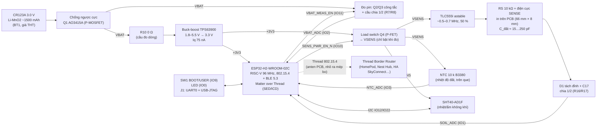

# 1. Sơ đồ khối và lựa chọn linh kiện

## 1.1 Sơ đồ khối



Bản vẽ khối trong KiCad nằm ở sheet gốc `hardware/h2-soil-sensor.kicad_sch` (xem `hardware/docs/schematic.pdf`, trang 1).

### Hình dạng vật lý (que cắm đất)

```
   ┌───────────────┐  ← anten PCB của module nhô ra ngoài mép bo 6 mm (không đồng bên dưới)
   │ ESP32-H2 mod. │  y = 0…14 mm
   ├───────────────┤
   │ nguồn, đo pin │  y = 15…52 mm  (TPS63900, Q1–Q4, SW1, LED, J1, đảo SHT40 có rãnh phay)
   ├───────────────┤
   │   CR123A      │  y = 57…101 mm (giá pin MYOUNG BH-123A)
   ├───────────────┤
   │ TLC555 + tách │  y = 102…121 mm (front-end đầu dò, sát mặt đất)
   ╞═══════════════╡  ← SOIL LINE (y = 124 mm) – phần dưới phủ conformal coating
   │ ║  SENSE    ║ │  điện cực GND hai mép + điện cực SENSE ở giữa, cả 2 lớp
   │ ║ (66 mm)   ║ │  NTC đặt ở ~5 cm dưới mặt đất (kênh riêng mép phải)
   │ ╚═══════════╝ │
    ╲             ╱   mũi nhọn, tổng chiều dài phần cắm ~88 mm
     ╲___________╱
```

Kích thước bo: 26 mm × 212 mm (phần điện tử 26 mm, que đầu dò 20 mm), FR4 2 lớp 1.6 mm.

## 1.2 Lựa chọn linh kiện và lý do

| Khối | Linh kiện | Lý do chọn |
|---|---|---|
| MCU / radio | **ESP32-H2-WROOM-02C-H4S** (4 MB flash) | 802.15.4 (Thread) + BLE 5.3 (commissioning), light-sleep 25 µA, deep-sleep 7 µA. Bản 4 MB để có 2 phân vùng OTA cho Matter (ảnh firmware ~1.7 MB). Anten PCB, nhiệt độ −40…105 °C. Module cần VDD 3.0–3.6 V → bắt buộc có bộ ổn áp vì CR123A sụt xuống 2.0 V cuối đời. |
| Nguồn | **TPS63900DSKR** (buck-boost) | Iq 75 nA, hiệu suất > 90 % ở 10 µA, Vin 1.8–5.5 V nên giữ 3.3 V ổn định từ pin mới (3.2–3.3 V) tới pin gần cạn (2.0 V), dòng ra > 400 mA đủ cho xung TX 140 mA (+20 dBm). Cấu hình bằng điện trở (R2D), không cần cầu chia hồi tiếp (không tốn dòng tĩnh). UVLO 1.75 V. Tương thích cả pin sạc RCR123A/16340 (3.0–4.2 V). |
| Cuộn cảm | TDK TFM252012ALMA2R2MTAA 2.2 µH | Giá trị TI khuyến nghị; Isat 2.6 A > 2 A (cấu hình “unlimited” input current), DCR 75 mΩ, 2520 (1008). |
| Chống ngược cực | **AO3415A** P-MOSFET | Mắc kiểu “ideal diode” (D→pin, S→tải, G→GND): không sụt áp như diode Schottky (~0.3 V là quá lớn với pin 3 V); Vgs(th) ≤ 1 V, Rds(on) ~ 50–65 mΩ ở Vgs = −1.8…−2.5 V → sụt < 20 mV ở 260 mA (xung TX khi pin còn 2.0 V). |
| Đo điện áp pin | AO3401A + 2N7002 + cầu 100k/100k | Cầu chia nối thẳng vào pin sẽ tốn 15 µA liên tục (~0.36 mAh/ngày – bằng ~50 % ngân sách!). Công tắc high-side P-FET (gate kéo lên VBAT bằng 1 MΩ) + N-FET dịch mức; R6 kéo gate N-FET xuống khi MCU ngủ → dòng rò chỉ còn cỡ nA. |
| Công tắc nguồn cảm biến | AO3401A + R9 100k | VSENS nuôi TLC555, NTC, SHT40, pull-up I²C; chỉ bật ~80 ms mỗi lần đo. R9 kéo gate lên 3V3 nên VSENS tắt cả khi GPIO ở trạng thái Hi-Z (reset, light-sleep tắt miền TOP, deep-sleep). |
| Bộ dao động đầu dò | **TLC555IDR** (CMOS, bản công nghiệp −40…85 °C) | Hoạt động từ 2 V, dòng thấp, tần số tới 2 MHz. Cấu hình duty 50 % bằng hồi tiếp OUT→RT→TR/THR (không dùng chân DIS nên không có dòng xả qua RA). Bản *C* (0…70 °C) không phù hợp ngoài trời. Thay thế: LMC555CMM (1.5 V, 3 MHz). Có thể bỏ 555 và kích thích bằng LEDC từ GPIO4 (R14). |
| Tách đỉnh | 1N4148WS + C17 10 nF + R16/R17 470k | 1N4148 có dòng rò ngược rất thấp (nA) so với Schottky (µA ở 50 °C) → ít trôi nhiệt; R16/R17 vừa chia 1/2 vào dải ADC 0–1.9 V (ATTEN 6 dB, sai số ±12 mV) vừa làm điện trở xả. |
| Đầu dò | Điện cực in trên PCB, 2 lớp | Điện cực đồng phẳng (coplanar): SENSE 8 × 66 mm ở giữa, GND 3 mm hai mép + thanh đáy; không có mặt GND ngay dưới SENSE nên điện dung ký sinh nhỏ, độ nhạy cao. Phủ solder mask + conformal coating → không có kim loại tiếp xúc đất (không ăn mòn điện hoá, không phụ thuộc mạnh độ dẫn điện như đầu dò điện trở). |
| Nhiệt độ đất | Murata NCP18XH103F03RB (NTC 10k, B3380, 1 %) | Đo nhiệt độ đất ở ~5 cm và bù trôi nhiệt của diode tách đỉnh; xuất ra cluster Temperature Measurement (tùy chọn của device type Soil Sensor). |
| Nhiệt/ẩm không khí | **SHT40-AD1F-R2** (có màng PTFE, IP67) | ±1.8 %RH / ±0.2 °C, 0.4 µA khi nghỉ, I²C. Bản *F* có màng lọc bảo vệ khỏi nước/bụi – cần cho môi trường ngoài trời. Có thể không lắp (Kconfig). |
| Giao diện | TS-1187A (nút), LED đỏ 0603 + 1 kΩ, header 1×8 2.54 mm | Nút trên IO9 (strapping BOOT + LP GPIO đánh thức), LED chỉ nháy khi cần (~1.5 mA). Header gồm UART0 + USB Serial/JTAG (IO26/IO27) để nạp/debug. |
| Giá pin | MYOUNG BH-123A-A1CJ002 (THT) | Có trên LCSC; môi trường ẩm nên dùng bản mạ vàng BH-123A-B5BA003 (C19184081). |
| Thạch anh 32 kHz | YXC X321532768KGD2SI (DNP) | Tùy chọn cho đồng hồ ngủ chính xác (CSL/SSED), mặc định dùng RC nội 136 kHz. |

### Phân bổ chân ESP32-H2-WROOM-02C

| Chân module | GPIO | Chức năng | Ghi chú |
|---|---|---|---|
| 27 | IO1 | SOIL_ADC (ADC1_CH0) | ATTEN 6 dB (0–1.9 V) |
| 26 | IO2 | VBAT_ADC (ADC1_CH1) | VBAT/2, ATTEN 6 dB |
| 25 | IO3 | NTC_ADC (ADC1_CH2) | ATTEN 12 dB (0–3.3 V) |
| 3 | IO4 | PROBE_EXC_MCU | kích thích LEDC tùy chọn (qua R14, DNP) |
| 5 | IO10 | SENS_PWR_EN_N | LP GPIO, mức thấp = bật VSENS |
| 6 | IO11 | VBAT_MEAS_EN | LP GPIO, mức cao = bật cầu chia pin |
| 10 / 15 | IO12 / IO22 | I²C SDA / SCL | pull-up 10 k lên VSENS |
| 8 | IO9 | BOOT/USER button | strapping (kéo lên 10 k), LP GPIO đánh thức light sleep |
| 7 | IO8 | strapping | kéo lên 10 k (R11) |
| 28 | IO0 | LED | active high |
| 11 / 12 | IO13 / IO14 | XTAL_32K_P/N | thạch anh 32 kHz (DNP) |
| 21 / 22 | IO23 / IO24 | UART0 RX / TX | header J1 |
| 23 / 24 | IO26 / IO27 | USB D− / D+ | header J1 |
| 4, 20 | IO5, IO25 | dự phòng | để trống (IO25 là strap JTAG – bị bỏ qua với eFuse mặc định) |

Nguyên tắc: các tín hiệu điều khiển công suất đặt trên **LP GPIO (IO8–IO14)** vì đây là các chân duy nhất còn hoạt động/giữ mức khi light-sleep tắt miền nguồn TOP (`CONFIG_PM_POWER_DOWN_PERIPHERAL_IN_LIGHT_SLEEP`), và mỗi tín hiệu đều có điện trở ngoài xác định trạng thái OFF an toàn.
