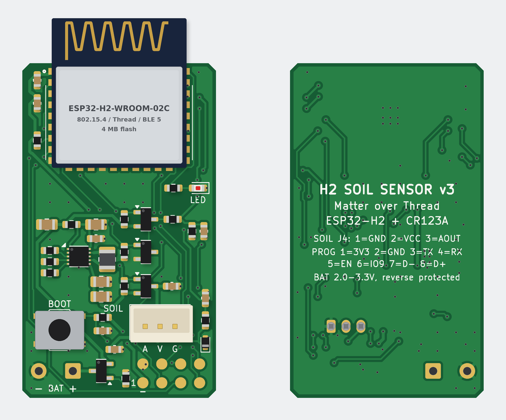

# 1. Sơ đồ khối và lựa chọn linh kiện

Phiên bản 3 là bo mạch **gọn nhất cho đúng một loại cảm biến**: module độ ẩm đất điện dung phổ biến
**“Capacitive Soil Moisture Sensor v1.2”**, nối bằng cáp JST-PH 2.0 3P. Trên bo chỉ còn ESP32-H2, tầng nguồn pin, công tắc
nguồn cho module, mạch vào analog có TVS, nút, LED, 2 pad pin và 8 pad nạp.

## 1.1 Sơ đồ khối

```
 ═══ Trên PCB 26 × 45 mm ════════════════════════════════════════════════════════════════════════════

  CR123A ──dây──► J3 2 pad hàn ───► Q1 AO3415A ──VBAT──► R10 0 Ω ──► U1 TPS63900 ──+3V3──► U2 ESP32-H2-WROOM-02C
  (hộp pin)       (+ vuông, − tròn) chống ngược cực │    cầu đo dòng  buck-boost 3.3 V      RISC-V 96 MHz
                                                    │                 Iq 75 nA              802.15.4 + BLE 5 ···))) Thread
                                                    │                                       (SED/ICD, anten nhô khỏi bo)
                                                    └──► Q2/Q3 + R7/R8: VBAT/2 ──► IO2 (VBAT_ADC), bật bởi IO11

                                       +3V3 ──► Q4 công tắc tải P-FET ◄── IO10 (SENS_PWR_EN_N, mức thấp = bật, soft-start)
                                                 │
                                                 │ VSENS: chỉ có điện khi đo (~1.5 s mỗi 15 phút)
                                                 ▼
                                   J4 JST-PH 2.0 3P: 1 GND, 2 VCC, 3 AOUT
                                   AOUT ─┬─ R12 1 kΩ ─┬─► IO1 (SOIL_ADC, ADC1, 12 dB)
                                         D3 TVS → GND C13 10 nF → GND

          SW1 BOOT/USER (IO9) · LED đỏ (IO0) · J1 8 pad nạp: 3V3 GND TX RX EN IO9 D− D+

 ═══ Ngoài PCB, nối bằng cáp PH2.0-3P ═══════════════════════════════════════════════════════════════
                                                 │
                                   module “Capacitive Soil Moisture Sensor v1.2”
                                   TLC555, AOUT 0–3 V, ~5 mA; cắm trong đất tới vạch giới hạn
```

Bản vẽ khối trong KiCad nằm ở sheet gốc `hardware/h2-soil-sensor.kicad_sch` (trang 1 của
[`hardware/docs/schematic.pdf`](../hardware/docs/schematic.pdf)).

### Hình dạng vật lý



```
               ┌─ anten PCB ──────┐  ← nhô 6 mm ra ngoài mép bo:
               │  (không đồng)    │    không kim loại, không cáp ở gần
   ╭───────────┴──────────────────┴───────╮  y = 0
   │ C9      U2 ESP32-H2-WROOM-02C        │
   │ C8      (18 × 20 mm)                 │
   │ R11                                  │  y ≈ 14
   │                         R22 LED D2   │  y ≈ 17
   │ nguồn TPS63900   đo pin Q2/Q3, R5–R8 │  y ≈ 20…32
   │ C1 R10 U1 L1     VSENS Q4 R9 C7      │
   │ C2…C5 R2…R4                     C13  │
   │ BOOT     SOIL J4 (A V G)        R12  │  y ≈ 32…38
   │ SW1      C14                    D3   │
   │ − BAT +   Q1 R1    J1  2 4 6 8       │  y ≈ 40.5 (hàng pad trong)
   │ (J3)                pad 1 3 5 7      │  y = 43   (hàng sát mép)
   ╰──────────────────────────────────────╯  y = 45
```

Không theo tỉ lệ. Bo 26 × 45 mm, FR4 2 lớp 1.6 mm, vát góc, **mọi linh kiện ở mặt trên**, **không có lỗ bắt vít** (cố định
bằng băng keo xốp 2 mặt, kẹp hoặc keo nến; có thể thêm lỗ M2/M3 nếu cần). Module ESP32-H2 ở giữa mép trên với anten nhô ra
ngoài; J4 ở nửa dưới, pad pin ở góc dưới trái, 8 pad nạp ở góc dưới phải. Chi tiết: [04-layout-pcb.md](04-layout-pcb.md).

## 1.2 Lựa chọn linh kiện trên bo và lý do

| Khối | Linh kiện | Lý do chọn |
|---|---|---|
| MCU / radio | **ESP32-H2-WROOM-02C-H4S** (4 MB flash) | 802.15.4 (Thread) + BLE 5.3 (commissioning), light-sleep 25 µA, deep-sleep 7 µA. Bản 4 MB để có 2 phân vùng OTA cho Matter (ảnh firmware ~1.7 MB). Anten PCB, nhiệt độ −40…105 °C. Module cần VDD 3.0–3.6 V → bắt buộc có bộ ổn áp vì CR123A sụt xuống 2.0 V cuối đời. |
| Nguồn | **TPS63900DSKR** (buck-boost) | Iq 75 nA, hiệu suất > 90 % ở 10 µA, Vin 1.8–5.5 V nên giữ 3.3 V ổn định từ pin mới (3.2–3.3 V) tới pin gần cạn (2.0 V), dòng ra > 400 mA đủ cho xung TX 140 mA (+20 dBm). Cấu hình bằng điện trở (R2D), không cần cầu chia hồi tiếp (không tốn dòng tĩnh). UVLO 1.75 V. Tương thích cả pin sạc RCR123A/16340 (3.0–4.2 V). |
| Cuộn cảm | TDK TFM252012ALMA2R2MTAA 2.2 µH | Giá trị TI khuyến nghị; Isat 2.6 A > 2 A (cấu hình “unlimited” input current), DCR 75 mΩ, 2520 (1008). |
| Chống ngược cực | **AO3415A** P-MOSFET | Mắc kiểu “ideal diode” (D→pin, S→tải, G→GND): không sụt áp như diode Schottky (~0.3 V là quá lớn với pin 3 V); Vgs(th) ≤ 1 V, Rds(on) ~ 50–65 mΩ ở Vgs = −1.8…−2.5 V → sụt < 20 mV ở 260 mA. Bảo vệ khi hàn nhầm dây đỏ/đen của hộp pin. |
| Cổng pin | **J3** – 2 pad xuyên lỗ hàn dây (pad 1 vuông “+”, pad 2 tròn “−”) | Đúng yêu cầu chỉ cần 2 cực để đấu pin: không đế pin, không đầu cắm trên bo → bo gọn, mối hàn không bị oxy hoá/lỏng như tiếp điểm cắm. Lỗ 1.1 mm, bước 4.6 mm (footprint KiCad cho dây 0.5 mm²). |
| Đo điện áp pin | AO3401A + 2N7002 + cầu 100k/100k | Cầu chia nối thẳng vào pin sẽ tốn 15 µA liên tục (~0.36 mAh/ngày). Công tắc high-side P-FET (gate kéo lên VBAT bằng 1 MΩ) + N-FET dịch mức; R6 kéo gate N-FET xuống khi MCU ngủ → dòng rò chỉ còn cỡ nA. |
| Công tắc nguồn module | AO3401A (Q4) + R9 100k, soft-start bằng firmware | Module đất tốn ~5 mA: nếu cấp liên tục = 120 mAh/ngày → hết pin sau ~10 ngày; bật ~1.5 s mỗi lần đo chỉ còn ~0.2 mAh/ngày. R9 kéo gate lên 3V3 nên VSENS tắt cả khi GPIO ở Hi-Z (reset, light-sleep, deep-sleep). |
| Cổng module | **J4** JST-PH 2.0 3P (B3B-PH-K-S), xuyên lỗ | Cùng loại cổng PH2.0-3P (GND, VCC, AOUT) có trên module → dùng cáp PH2.0-3P hai đầu; chân xuyên lỗ chịu lực kéo cáp tốt hơn SMD. |
| Chống ESD | **D3** LRC LESD5Z3.3T1G (SOD-523, C136161) | Chỉ còn một đường tín hiệu ra khỏi hộp (AOUT) → một TVS nhỏ thay cho mảng 4 kênh. Điện áp làm việc 3.3 V ≥ AOUT tối đa 3.0 V; theo mô tả LCSC: 200 W (8/20 µs), kẹp 14.1 V ở 11.2 A, 105 pF, rò ≤ 1 µA. Thay thế: onsemi ESD5Z3.3T1G (C61148, rò 50 nA, tồn kho ít). |
| Front-end analog | R12 1 kΩ + C13 10 nF | R12 hạn dòng vào IO1 khi cáp nhận xung/quá áp; C13 lọc nhiễu cáp và cấp điện tích cho tụ lấy mẫu ADC. |
| Tụ VSENS | C7 1 µF + C14 1 µF | Cố ý nhỏ để hạn dòng nạp khi Q4 đóng (module đã có tụ riêng). |
| Pad nạp | **J1** – 8 pad tròn SMD Ø1.5 mm, lưới 2.54 mm, không kem hàn | Thay header 1×8: bo mỏng và gọn hơn, không có chân kim loại nhô ra (ít ăn mòn), không tốn linh kiện; lưới 2.54 mm hợp với kẹp/đồ gá pogo phổ biến, hoặc hàn dây tạm. |
| Giao diện | TS-1187A (nút), LED đỏ 0603 + 1 kΩ | Nút trên IO9 (strapping BOOT + LP GPIO đánh thức), LED chỉ nháy khi cần (~1.5 mA). |

Đồng hồ ngủ dùng RC nội 136 kHz của ESP32-H2 (bo v3 không còn vị trí cho thạch anh 32.768 kHz).

## 1.3 Module cảm biến “Capacitive Soil Moisture Sensor v1.2”

| Mục | Nội dung |
|---|---|
| Thông số | Nguồn 3.3–5.5 V DC, dòng 5 mA, ngõ ra **analog** 0–3.0 V, cổng PH2.0-3P (GND, VCC, AOUT), dài 98 mm ([DFRobot SEN0193 wiki](https://wiki.dfrobot.com/sen0193/), [Core Electronics](https://core-electronics.com.au/capacitive-soil-moisture-sensor-corrosion-resistant.html)). Điện áp ra **cao khi khô, thấp khi ướt**. |
| Cảnh báo về tin bán hàng | Các thông số “60 µA / 300 µW”, “chân DO”, “biến trở xanh”, “ngõ ra số 0 V / 5 V” thường bị chép từ cảm biến loại **điện trở** (có bo so sánh). Module điện dung v1.2 chỉ có 3 chân (GND, VCC, AOUT), ngõ ra analog 0–3 V, dòng ~5 mA. |
| Kiểm tra khi nhận hàng | Đọc chữ trên IC 8 chân: nên là **TLC555** (CMOS, chạy ở 3.3 V), không phải NE555 (không chạy ở 3.3 V); **thử trong không khí và trong nước**: chênh lệch AOUT nên ≥ ~1 V (firmware mặc định: khô 2.5 V, ướt 1.2 V); loại module lỗi lắp ráp. |
| Cáp | Cáp đi kèm thường là PH2.0 (đầu module) → Dupont 2.54 mm cái, **không cắm được vào J4**: mua cáp PH2.0-3P hai đầu loại nối thẳng hoặc bấm lại đầu PH; đo để chắc GND → J4-1, VCC → J4-2, AOUT → J4-3. |
| Lắp đặt | Chỉ phần đầu dò được phủ: bịt kín phần linh kiện và mép cắt PCB của module; chỉ cắm tới vạch giới hạn (xem [07](07-rui-ro-ngoai-troi.md)). |
| Pin + hộp pin | 1 × CR123A 3 V Li-MnO<sub>2</sub> ~1500 mAh, hộp pin có dây hàn vào J3 – **kiểm tra cực bằng đồng hồ** trước khi hàn. |

## 1.4 Phân bổ chân ESP32-H2-WROOM-02C

| Chân module | GPIO | Chức năng | Ghi chú |
|---|---|---|---|
| 27 | IO1 | SOIL_ADC (ADC1_CH0) | AOUT module qua R12; ATTEN 12 dB (0–3.3 V) |
| 26 | IO2 | VBAT_ADC (ADC1_CH1) | VBAT/2, ATTEN 6 dB |
| 5 | IO10 | SENS_PWR_EN_N | LP GPIO, mức thấp = bật VSENS (R9 giữ tắt) |
| 6 | IO11 | VBAT_MEAS_EN | LP GPIO, mức cao = bật cầu chia pin (R6 giữ tắt) |
| 8 | IO9 | BOOT/USER button | strapping (kéo lên 10 k, R21), LP GPIO đánh thức light sleep; J1-6 |
| 7 | IO8 | strapping | kéo lên 10 k (R11) |
| 28 | IO0 | LED | active high |
| 21 / 22 | IO23 / IO24 | UART0 RX / TX | J1-4 / J1-3 |
| 23 / 24 | IO26 / IO27 | USB D− / D+ | J1-7 / J1-8 |
| 25, 3, 4, 10, 11, 12, 15, 20 | IO3, IO4, IO5, IO12, IO13, IO14, IO22, IO25 | không dùng | NC trên bo, firmware đặt Hi-Z (IO25 là strap JTAG – bị bỏ qua với eFuse mặc định) |
| 2 / 1 / 14 | EN / 3V3 / VBAT | | EN ra J1-5 (module có RC sẵn); 3V3 có C8 + C9, ra J1-1; VBAT để NC |

Nguyên tắc: các tín hiệu điều khiển công suất đặt trên **LP GPIO (IO8–IO14)** vì đây là các chân duy nhất còn hoạt động/giữ
mức khi light-sleep tắt miền nguồn TOP (`CONFIG_PM_POWER_DOWN_PERIPHERAL_IN_LIGHT_SLEEP`) – firmware dùng `gpio_hold` để giữ
VSENS bật trong lúc chip light-sleep chờ module ổn định – và mỗi tín hiệu đều có điện trở ngoài xác định trạng thái OFF an toàn.
