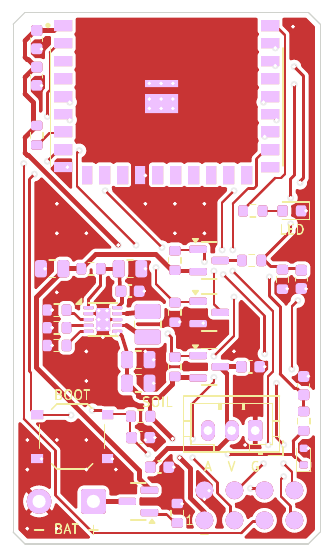
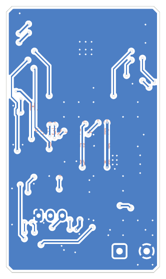

# 4. Hướng dẫn layout PCB

File KiCad: `hardware/h2-soil-sensor.kicad_pcb` (KiCad 7 trở lên; mở bằng KiCad 8/9 sẽ tự nâng định dạng).
Bo v3 đã được đặt linh kiện, đi dây đầy đủ (27/27 net tín hiệu; GND bằng đổ đồng), đổ đồng GND hai lớp và khâu via.
**DRC: 0 vi phạm, 0 pad chưa nối, 0 lỗi footprint** (`hardware/docs/drc_report.txt`). File sản xuất: `hardware/fab/`
(Gerber + khoan zip, BOM, CPL). Ảnh minh hoạ lắp ráp: [`render.png`](../hardware/docs/render.png) (mặt trên + mặt dưới),
[`render_top.png`](../hardware/docs/render_top.png), [`render_bottom.png`](../hardware/docs/render_bottom.png); vị trí + ký hiệu
linh kiện: [`assembly_top.pdf`](../hardware/docs/assembly_top.pdf).

| Mặt trên (F.Cu + silkscreen) | Mặt dưới (B.Cu, nhìn gương) |
|---|---|
|  |  |

## 4.1 Thông số bo

| Mục | Giá trị |
|---|---|
| Kích thước | 26 × 45 mm, vát 4 góc 1 mm; module U2 nhô thêm 6 mm (vùng anten) qua mép trên |
| Lớp | 2 lớp, FR4 1.6 mm, đồng 1 oz; **mọi linh kiện ở mặt trên**; không có lỗ bắt vít |
| Luật | track mặc định 0.2 mm / khe hở 0.2 mm; net *Power* (+3V3, VBAT, VBAT_RAW, VIN_BB, LX1/2, VSENS, GND) 0.4 mm; net *Analog* (SOIL_AOUT, SOIL_ADC, VBAT_ADC) 0.25 mm, khe hở 0.3 mm; via 0.6/0.3 mm; đồng–mép bo 0.45 mm (router giữ 0.5 mm); lỗ–lỗ 0.25 mm |
| Lỗ khoan | 0.3 mm (via, via nhiệt), 0.75 mm (J4 JST-PH), 1.1 mm (pad dây pin J3); không có lỗ không mạ |
| Kết quả đi dây | 249 đoạn dây (F.Cu 360 mm, B.Cu 137 mm); 102 via 0.6/0.3 mm = 48 via tín hiệu + 54 via GND (27 fan-out + 27 khâu) |
| Khả năng sản xuất | Nằm trong năng lực tiêu chuẩn JLCPCB/PCBWay 2 lớp (footprint TPS63900 dùng via nhiệt 0.3 mm) |

## 4.2 Bố trí theo vùng

Toạ độ bo (mm), gốc ở góc trên trái, y tăng xuống dưới.

| Vùng | Nội dung | Lưu ý |
|---|---|---|
| y −6…0 (ngoài bo) | Anten PCB của module | Không bo, không đồng, không linh kiện; trong hộp không để cáp, pin, vật kim loại ở phía này; vỏ cách anten ≥ 15 mm |
| x 4…22, y 0…14 | U2 ESP32-H2-WROOM-02C, giữa mép trên (x = 13) | Module sát mép, vùng anten nhô ra ngoài (phương án tốt nhất theo *ESP32-H2 Hardware Design Guidelines*); mặt trên dưới thân module chỉ có GND (router cấm đi dây lớp trên), 9 via nhiệt ở EPAD |
| x ≈ 2, y 2…11 | C9, C8 sát chân 3V3, R11 (IO8) | |
| x 20…24, y ≈ 17 | LED D2 + R22 | Ngay dưới module, nhãn “LED” |
| x 2…12, y 20…32 | Tầng nguồn TPS63900: C1, R10, C2, C3, U1, L1, C4, C5, R2–R4 | Vòng VIN và VOUT ngắn nhất, đi dây tay và khoá |
| x 13…25, y 20…31 | Đo pin (Q2, Q3, R5–R8, C6) + công tắc VSENS (Q4, R9, C7) | |
| x 2…11, y 32…38 | SW1 BOOT, R21, C21 | Nhãn “BOOT” |
| x 16.5…20.5, y 35.4 | J4 SOIL, xoay 180° (chân 1 GND ở x 20.5, 2 VCC ở 18.5, 3 AOUT ở 16.5) | Thân cổng quay lên trên, xa hàng pad nạp; nhãn “A V G” phía dưới cổng; C14 ở x 12.4, y 38.5 |
| x ≈ 24.6, y 31…38 | C13, R12, D3 | Chuỗi vào analog cạnh chân AOUT của J4 |
| góc dưới trái, y = 41.4 | J3: “−” pad tròn (x 2.2), “+” pad vuông (x 6.8); Q1 (x 10.6), R1 | Nhãn “− BAT +” |
| góc dưới phải, x 16.2…23.8 | J1: hàng sát mép y = 43.0 (pad 1, 3, 5, 7), hàng trong y = 40.46 (pad 2, 4, 6, 8) | Chữ “1” cạnh pad 1; sơ đồ chân xem bảng trong `hardware/README.md` |

## 4.3 Quy tắc layout quan trọng

### Anten và RF
1. Vùng anten của module **không có đồng ở mọi lớp** – ở bo này vùng anten nằm hẳn ngoài mép bo.
2. GND liên tục dưới thân module, nhiều via GND quanh module để làm “mặt phẳng phản xạ” cho anten.
3. Cổng module, pad pin và pad nạp đều ở nửa dưới bo; khi lắp vào hộp, đi cáp và đặt hộp pin phía dưới bo, không vòng qua
   đầu anten. Vỏ nhựa không pha carbon/kim loại, khe hở ≥ 15 mm.
4. Đường UART/USB đi từ module xuống pad J1 ở góc dưới, không chạy sát vùng anten.

### Tầng nguồn TPS63900
1. C2 (10 µF) + C3 (100 nF) sát VIN/GND; C4/C5 (2 × 22 µF) sát VOUT/GND – đây là hai vòng dòng xung quan trọng nhất.
2. L1 ngay cạnh LX1/LX2; đường LX ngắn, rộng (0.4 mm) và **không** chạy dưới các tín hiệu analog.
3. EP (pad nhiệt) nối GND bằng 6 via 0.3 mm; chân SEL và GND (pin 8) nối thẳng vào EP.
4. Điện trở CFG1–3 sát chân, không có tụ, đường ngắn (< 10 pF).
5. R10 (0 Ω) đặt trên đường VBAT→VIN_BB để đo dòng (tháo ra, gắn ampe kế/PPK2).

### Cổng module, analog và ESD
1. D3 → R12 → C13 xếp thành chuỗi ngay cạnh chân AOUT của J4: xung từ cáp bị kẹp trước khi đi tiếp vào bo; net analog
   0.25 mm, khe hở 0.3 mm, không chạy song song đường LX.
2. C14 (tụ đệm VSENS) cạnh J4; C7 cạnh Q4.
3. J4 là linh kiện xuyên lỗ → chịu lực kéo cáp; nên thêm dây rút/keo giữ cáp trong hộp.

### Pad nạp J1 và pad pin J3
1. J1: 8 pad tròn SMD Ø1.5 mm trên lưới 2.54 mm, **không có kem hàn** (pad phẳng cho kim pogo), mở mask đủ pad; pad đủ lớn
   để chịu sai lệch khi tì đồ gá bằng tay. J4 được xoay 180° để thân cổng (cao ~6 mm) quay ra xa hàng pad: tâm hàng pad trong cách mép thân J4 ~3 mm,
   đủ chỗ cho kẹp pogo 2 hàng thông thường; nếu đồ gá quá rộng thì nạp lần đầu trước khi hàn J4.
2. J3: pad xuyên lỗ lỗ 1.1 mm (dây 0.5 mm²), pad “+” vuông; dây pin nên được giữ thêm bằng keo/dây rút để không giật mối hàn.
3. Silkscreen mặt trên chỉ ghi nhãn cho người dùng (BOOT, LED, SOIL, “A V G”, “1”, “− BAT +”); mặt dưới chỉ in tên bo
   (H2 SOIL SENSOR v3, Matter over Thread, ESP32-H2 + CR123A, BAT 2.0–3.3V), “Design by Haxeko” và “Made in Vietnam”;
   sơ đồ chân J1/J4 xem bảng ở mục 4.2 và trong `hardware/README.md`.
   Ký hiệu linh kiện nằm ở lớp F.Fab (xem `assembly_top.pdf`).

### Nối đất, khâu via, cố định bo
- Mặt GND ở cả 2 lớp trên toàn bo (khe hở vùng đổ 0.3 mm, độ dày tối thiểu 0.25 mm, thermal relief 0.3/0.4 mm cho chân THT).
- 27 via fan-out cho pad GND SMD + 27 via khâu theo lưới 2.5 mm; mọi đảo đồng phải chạm via/lỗ GND, nếu không được thêm via
  hoặc tự loại bỏ. Đường tín hiệu chủ yếu ở lớp trên (200/249 đoạn).
- Không có lỗ bắt vít để bo gọn nhất: dán mặt dưới bằng băng keo xốp 2 mặt, dùng kẹp hoặc keo nến. Lỗ M2/M3 có thể thêm theo yêu cầu.

## 4.4 Quy trình tạo/tái tạo bo (tự động hoá)

Toàn bộ phần cứng được sinh bằng script Python (`hardware/tools/`), có thể chỉnh và chạy lại:

```bash
cd hardware/tools
python3 gen_footprints.py ..      # thư viện riêng: symbol ESP32-H2/VBAT/VSENS, footprint module, pad nạp 2×4, WSON-10 via 0.3 mm
python3 gen_schematic.py ..       # 5 sheet schematic từ design.py
python3 check_netlist.py ../h2-soil-sensor.kicad_sch   # đối chiếu netlist ↔ design.py
python3 gen_pcb.py --check        # chỉ kiểm tra chồng courtyard / ra ngoài bo (fpinfo.py)
python3 gen_pcb.py                # đặt linh kiện, đi dây vòng TPS63900 (khoá), fan-out GND, router 2 lớp, đổ đồng, DRC
python3 make_fab.py               # Gerber+khoan zip, BOM/CPL JLCPCB, not_assembled.csv, PDF schematic/PCB/lắp ráp, PNG
python3 render.py                 # ảnh minh hoạ render_top/render_bottom/render.png
```

- Vị trí linh kiện nằm trong bảng `PLACE` của `gen_pcb.py` (toạ độ bo, mm, mặt trên); đường viền vát góc `OUTLINE`;
  nhãn silkscreen `LABELS` (mặt trên) và `BACK_TEXT` (mặt dưới). Footprint pad nạp sinh bởi `prog_pads()` trong `gen_footprints.py`.
- `router.py` là bộ đi dây lưới 0.1 mm hai lớp: A* 8 hướng với chi phí via (14), lớp dưới (×1.8) và đổi hướng (0.4); bản đồ
  chiếm chỗ cho từng cặp bề rộng/khe hở (vật cản được phình theo w/2 + khe hở + 0.05 mm) nên kết quả đạt DRC theo cấu trúc.
  Net ngắn và net nguồn đi trước; net thất bại được đưa lên đầu và đi lại (tối đa 8 lượt – lần chạy hiện tại: 1 lượt,
  27/27 net). Vùng cấm: lớp trên dưới thân module.
- `gen_pcb.py` tự chạy lại chính nó với `PYTHONHASHSEED=0` → thứ tự net và kết quả đi dây **lặp lại y hệt** mỗi lần.
- Các script giả định thư viện KiCad ở `/usr/share/kicad/` (Linux). Chạy lại `gen_pcb.py` sẽ ghi đè mọi chỉnh sửa tay; nếu muốn
  tối ưu thẩm mỹ, mở `.kicad_pcb` trong KiCad, xoá dây không khoá rồi đi lại bằng tay hoặc Freerouting.

## 4.5 Lưu ý đặt hàng và lắp ráp

| Mục | Chọn |
|---|---|
| Độ dày | 1.6 mm |
| Bề mặt | ENIG nếu dùng kẹp pogo thường xuyên (pad phẳng, không oxy hoá); HASL không chì cũng được |
| Via | Tented hoặc để hở đều được; tented giúp lớp conformal coating và băng keo mặt dưới phẳng hơn |
| SMT | Mặt trên: 35 linh kiện / 22 mã theo BOM + CPL trong `hardware/fab/` |
| THT | J4 hàn tay (hoặc dịch vụ THT); dây hộp pin hàn vào J3 |
| Module ESP32-H2 | Hàn reflow 1 lần (MSL3) hoặc consign; hàn tay cần hot-air/bếp gia nhiệt cho EPAD |
| Pad nạp J1 | Không thêm kem hàn; chỉ tráng thiếc khi muốn hàn dây cố định |
| Kiểm tra sau lắp ráp | Dòng nền tại R10 ≈ 30–35 µA (phía pin, giữa các lần đo); VSENS (J4-2) = 0 V khi ngủ và ≈ 3.3 V trong ~1.5 s mỗi lần đo; AOUT (J4-3): trong không khí ~2.2–2.8 V, trong nước ~1.0–1.4 V |
